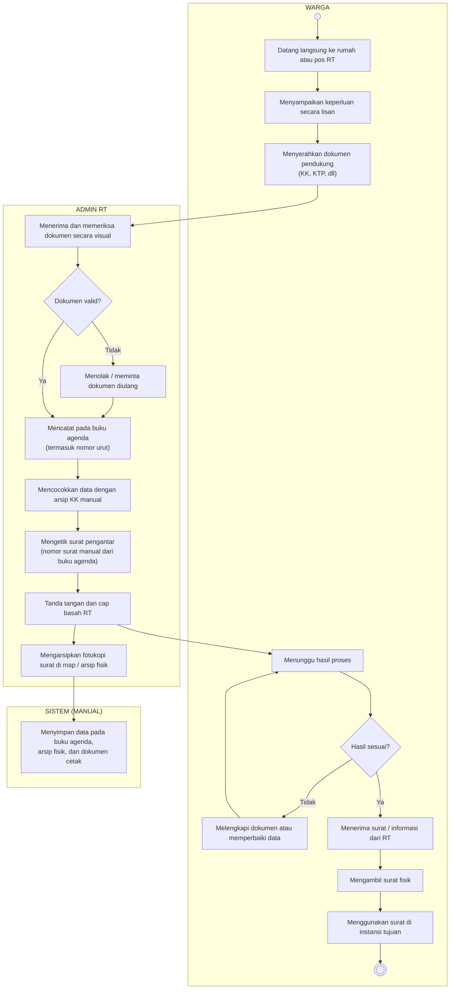
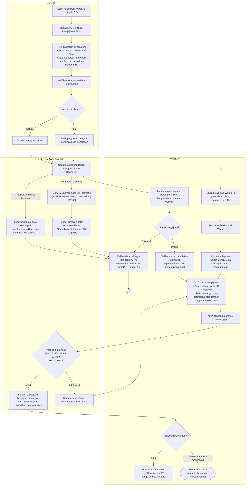
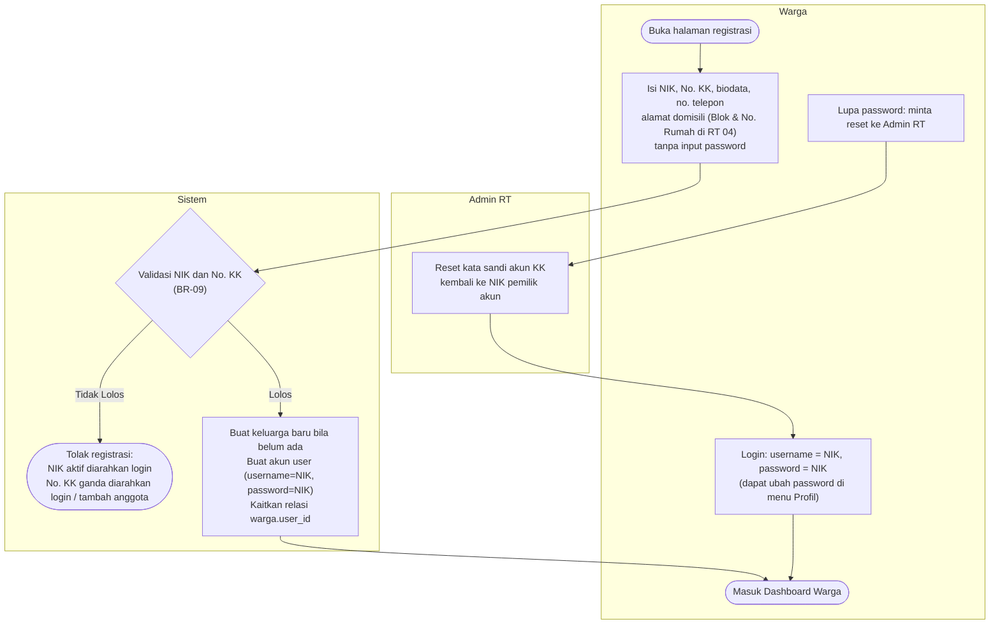
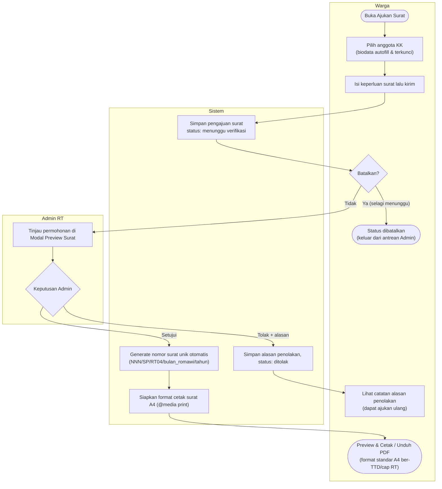
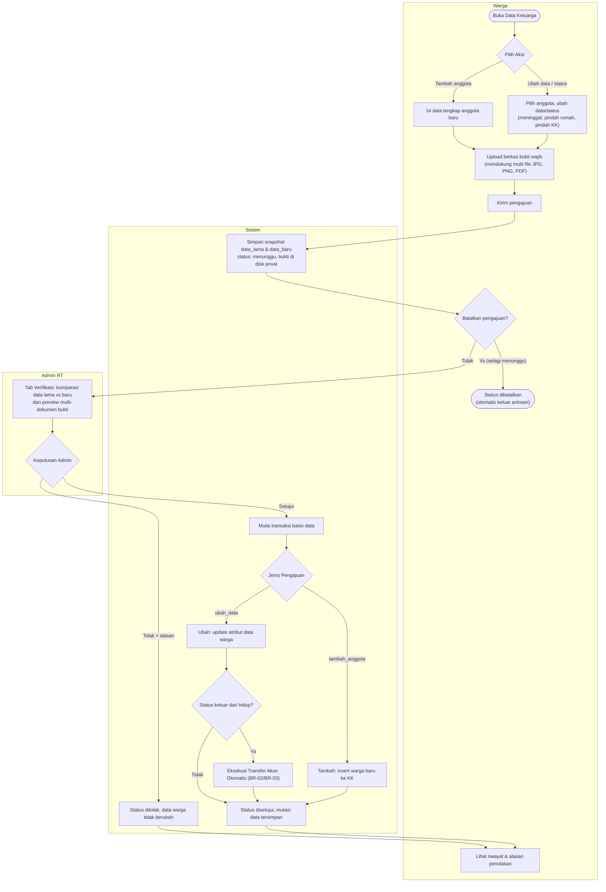
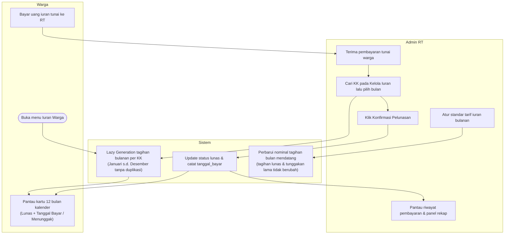
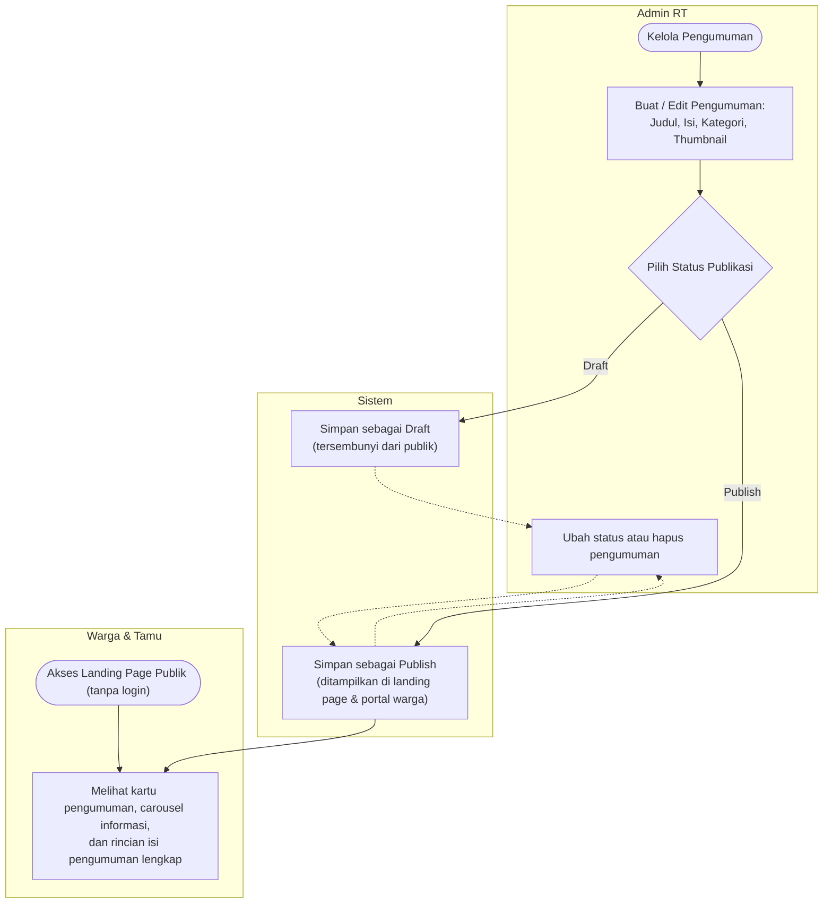

# Alur Bisnis Proses — Aplikasi Informasi Warga "WargaKu"

**Project PBL-TRPL102 | Lingkup Wilayah RT 04**  
*Format Dokumentasi: Activity Diagram Swimlane (Mermaid) & Penjelasan Alur Sistem*

Dokumen ini memetakan proses bisnis kependudukan dan administrasi rukun tetangga, membandingkan antara proses konvensional manual (**Current / As-Is**) dengan sistem digital terintegrasi aplikasi WargaKu (**To-Be**), sesuai spesifikasi PRD v2.8 dan Dokumen SRS (Lampiran 1).

---

## DAFTAR ISI
1. [Activity Diagram Utama: Current (As-Is / Manual)](#1-activity-diagram-utama-current-as-is--manual)
2. [Activity Diagram Utama: To-Be (Sistem WargaKu)](#2-activity-diagram-utama-to-be-sistem-wargaku)
3. [Rincian Alur Bisnis per Modul Sistem](#3-rincian-alur-bisnis-per-modul-sistem)
   - 3.1 [Registrasi & Akses Akun KK](#31-alur-registrasi--akses-akun-kk)
   - 3.2 [Pengajuan Surat Pengantar Daring](#32-alur-pengajuan-surat-pengantar-daring)
   - 3.3 [Perubahan Data Keluarga & Mutasi Kependudukan](#33-alur-perubahan-data-keluarga--mutasi-kependudukan)
   - 3.4 [Pengelolaan Iuran Warga (12 Bulan)](#34-alur-pengelolaan-iuran-warga-12-bulan)
   - 3.5 [Publikasi Pengumuman Digital](#35-alur-publikasi-pengumuman-digital)
4. [Tabel Komparasi Proses Bisnis (Current vs To-Be)](#4-tabel-komparasi-proses-bisnis-current-vs-to-be)

---

## 1. Activity Diagram Utama: Current (As-Is / Manual)

Diagram ini menggambarkan alur kerja pengurusan administrasi warga konvensional sebelum adanya aplikasi. Proses bertumpu pada kehadiran fisik, pemeriksaan dokumen manual di tempat, pengetikan mandiri oleh pengurus RT, dan pengarsipan berbasis kertas map fisik.

### Kelemahan Proses Manual (Current):
1. **Inefisiensi Waktu**: Warga harus datang langsung ke rumah pengurus RT pada jam luang pengurus dan sering kali harus menunggu tanpa kepastian.
2. **Keterbatasan Pelacakan**: Tidak ada pencatatan riwayat perubahan data kependudukan lama (data langsung ditimpa atau dicoret di buku fisik).
3. **Risiko Redundansi & Kesalahan Manusia**: Penomoran surat manual dari buku agenda rawan ganda atau terlewat saat pengurus berganti.
4. **Kerentanan Arsip**: Arsip kertas berisiko rusak, terselip, atau hilang dimakan usia dan bencana fisik.

---

## 2. Activity Diagram Utama: To-Be (Sistem WargaKu — Versi Proyek Selesai)

Diagram ini menggambarkan alur kerja digital terintegrasi yang **sudah selesai diimplementasikan secara riil pada aplikasi WargaKu**, memisahkan tanggung jawab antara antarmuka **Warga**, otomasi **Sistem Backend**, dan kendali verifikasi **Admin RT**.

---

## 3. Rincian Alur Bisnis per Modul Sistem

### 3.1 Alur Registrasi & Akses Akun KK

1. **Warga** membuka halaman registrasi tanpa memasukkan kata sandi. Warga menginput NIK, No. KK, data identitas lengkap, nomor WhatsApp/telepon aktif, dan **alamat domisili lokal RT 04 (Blok & Nomor Rumah)**.
2. **Sistem** memvalidasi NIK & No. KK sesuai aturan bisnis **BR-09**:
   - Jika NIK sudah terdaftar aktif (`hidup`), registrasi ditolak dan diarahkan ke halaman login.
   - Jika NIK berstatus `pindah_kk`, sistem mengizinkan pendaftaran KK baru dan memperbarui data kependudukannya.
   - Jika lolos, sistem otomatis membuat akun dengan `username = NIK` dan `password = NIK` (terenkripsi *Bcrypt*).
3. **Admin RT** bertindak sebagai pemulih akun: jika warga lupa kata sandi, Admin RT memiliki tombol aksi untuk mereset kata sandi akun KK kembali ke NIK pemilik akun secara aman.

---

### 3.2 Alur Pengajuan Surat Pengantar Daring

1. **Warga** memilih menu *Ajukan Surat*. Formulir menyediakan dropdown anggota keluarga yang berstatus hidup; biodata pemohon (nama, tempat/tgl lahir, pekerjaan, agama, alamat) terisi otomatis (*autofill*) dan terkunci guna mencegah manipulasi. Warga hanya mengisi kolom keperluan surat.
2. Selama pengajuan berstatus `menunggu`, warga dapat membatalkannya melalui tombol *Batalkan*.
3. **Admin RT** membuka menu *Proses Pengajuan Surat*, meninjau berkas permohonan melalui *modal preview* draf surat:
   - Jika ditolak: Admin memberikan alasan penolakan.
   - Jika disetujui: Sistem otomatis men-generate **nomor surat resmi unik** dengan format `NNN/SP/RT04/{bulan_romawi}/{tahun}` (**BR-05**).
4. **Warga** dapat langsung melihat status disetujui dan mencetak/mengunduh surat berformat standar kertas A4 (`@media print`) lengkap dengan tanda tangan digital dan stempel RT.

---

### 3.3 Alur Perubahan Data Keluarga & Mutasi Kependudukan

1. **Warga** membuka menu *Data Keluarga* dan memilih salah satu dari dua aksi:
   - **Ubah Data / Status Warga**: Mengoreksi biodata atau memperbarui status (*hidup, meninggal, pindah rumah, pindah KK*). NIK dan No. KK dikunci.
   - **Tambah Anggota Baru**: Mengisi data lengkap anggota baru yang baru lahir atau baru bergabung dalam KK.
2. Warga mengunggah berkas bukti pendukung (**mendukung multi-upload file JPG/PNG/PDF**) lalu mengirim pengajuan.
3. Warga dapat membatalkan pengajuan sebelum diverifikasi admin.
4. **Admin RT** memeriksa pengajuan pada tab verifikasi yang membandingkan secara berdampingan: *Data Lama vs Data Baru* beserta penampil berkas bukti (*multi-document tab*).
5. **Otomasi Sistem saat Disetujui**:
   - Jika status warga berubah keluar dari `hidup` (meninggal/pindah): Sistem secara otomatis mengeksekusi **BR-02 (Transfer Kepemilikan Akun KK)** ke anggota keluarga lain yang masih hidup (hierarki: Kepala Keluarga baru -> Suami/Istri -> Anak tertua 17+ -> Anggota tertua).
   - Jika seluruh anggota KK telah pindah/meninggal: Akun dinonaktifkan/dihapus otomatis (**BR-03**).

---

### 3.4 Alur Pengelolaan Iuran Warga (12 Bulan)

Aplikasi WargaKu menggunakan pencatatan non-payment gateway (pembayaran riil tetap tunai ke pengurus RT) dengan sistem digital terpadu:
1. **Penerbitan Malas (*Lazy Generation*)**: Saat warga atau admin membuka modul iuran, sistem otomatis menerbitkan kartu tagihan bulanan dari bulan awal terdaftar hingga Desember tanpa duplikasi.
2. **Warga**: Memiliki tampilan transparan berupa kartu 12 bulan kalender (*Januari s.d. Desember*) yang menunjukkan status tagihan: *Lunas* (beserta tanggal bayar), *Menunggak*, atau *Belum Masuk Periode*.
3. **Admin RT**: Mengonfirmasi pelunasan secara manual saat menerima uang kas, melihat rekap penerimaan tahunan per KK, dan dapat menyesuaikan tarif iuran standar melalui pop-up pengaturan (penyesuaian tarif hanya berlaku untuk bulan berjalan ke depan).

---

### 3.5 Alur Publikasi Pengumuman Digital

1. **Admin RT** membuat pengumuman dengan judul, rincian informasi, kategori, dan thumbnail opsional.
2. Admin RT dapat menentukan status: disimpan sebagai **Draft** (hanya terlihat oleh pengurus) atau **Publish** (diterbitkan luas).
3. **Warga & Masyarakat** dapat langsung membaca pengumuman berstatus *Publish* pada halaman beranda depan (*Landing Page*) secara publik tanpa harus login terlebih dahulu.

---

## 4. Tabel Komparasi Proses Bisnis (Current vs To-Be)

| Parameter Proses | Proses Manual (Current / As-Is) | Sistem WargaKu (To-Be) | Dampak & Nilai Tambah |
| :--- | :--- | :--- | :--- |
| **Penyampaian Keperluan** | Warga harus mendatangi rumah pengurus RT secara langsung membawa berkas fisik. | Pengajuan dilakukan secara daring melalui ponsel/laptop kapan saja dari rumah. | Menghemat waktu dan tenaga warga; pengurus RT tidak terganggu jam istirahatnya. |
| **Identitas & Formulir** | Ditulis tangan atau diisi manual secara berulang di kertas; rawan salah tulis biodata. | Biodata pemohon otomatis ditarik dari basis data KK yang valid (*autofill & locked*). | Mencegah *human-error* dan manipulasi data identitas warga. |
| **Pemeriksaan Dokumen** | Dokumen fotokopi diperiksa sekilas dengan mata telanjang; arsip fisik rentan tercecer. | Berkas bukti diunggah langsung (*multi-upload* gambar/PDF) dan ditinjau pada tab verifikasi sistem. | Dokumen tersimpan rapi pada penyimpanan privat digital yang aman dan dapat dilacak kapan pun. |
| **Kepastian & Status** | Warga tidak tahu progres surat dan harus datang berulang kali untuk menanyakan. | Status terpantau secara *real-time* (*Menunggu*, *Disetujui*, *Ditolak* lengkap dengan alasan, atau *Dibatalkan*). | Transparansi penuh; warga memperoleh kepastian status tanpa perlu bertanya langsung. |
| **Penomoran Surat** | Ditulis manual dari buku agenda; rentan nomor ganda atau terlompat. | Dibuat otomatis oleh sistem dengan format standar resmi penomoran unik per tahun (**BR-05**). | Menjamin integritas urutan arsip surat dan standar formalitas kelembagaan RT. |
| **Output Dokumen** | Diketik manual satu per satu di word processor lalu dicetak dan dicap basah. | Sistem langsung merender tampilan cetak A4 terstandarisasi (`@media print`) siap unduh/cetak mandiri. | Format surat seragam, rapi, dan cepat terbit hitungan detik setelah disetujui. |
| **Pencatatan Iuran** | Dicatat di buku kas atau spreadsheet manual; warga tidak bisa memeriksa riwayatnya sendiri. | Dasbor kartu 12 bulan interaktif per KK; warga dapat melihat histori pelunasan secara transparan. | Mencegah selisih pencatatan uang kas dan mempermudah rekap keuangan bagi pengurus RT. |
| **Penyebaran Informasi** | Mengandalkan secarik kertas di pos ronda atau pesan broadcast chat yang mudah tertimbun. | Diterbitkan di *Landing Page* publik terpusat dengan thumbnail, filter, dan status publikasi. | Informasi RT tersampaikan serentak, rapi, dan memiliki arsip berita yang mudah ditelusuri. |
