# Diagram Arsitektur & Workflow — Aplikasi Informasi Warga "WargaKu"

Project PBL-TRPL102 | RT 04 | Laravel 12 + MySQL | Format: Mermaid
Disinkronkan dengan: `DB_WAR.dbml` (7 tabel, relasi keluarga via `keluarga_id`), laporan RPL-102 (revisi 1), dan `PRD_WargaKu.md` v2.6 (2026-10-02). Jika ada pertentangan, urutan prioritas mengikuti PRD Bagian 0.1; diagram ini hanya ilustrasi alur.

Daftar isi: (1) Arsitektur, (2) Aktor & fitur, (3) ERD 7 tabel, (4) State pengajuan, (5) State status warga, (6) Registrasi, (7) Perubahan data & verifikasi, (8) Transfer kepemilikan akun, (9) Autentikasi, (10) Surat, (11) Iuran, (12) Catatan sinkronisasi.

---

## 1. Arsitektur Sistem

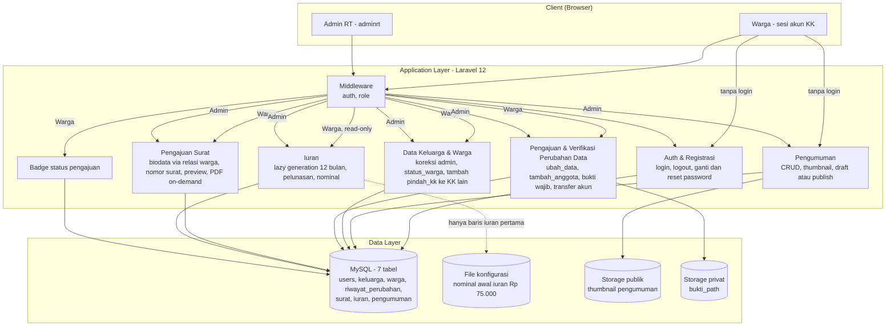

---

## 2. Aktor & Fitur

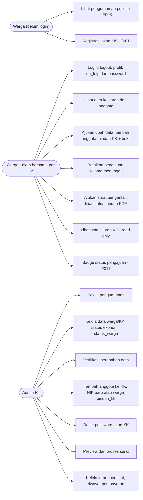

---

## 3. ERD — 7 Tabel

> Semua tabel punya `created_at` dan `updated_at` (tidak digambar). `keluarga.id` adalah PK; `keluarga.no_kk` UNIQUE (identitas nomor KK, bukan kunci relasi). Semua relasi ke keluarga memakai `keluarga_id`. Constraint tambahan: `iuran` unique `(keluarga_id, bulan, tahun)`; index `warga(keluarga_id)`, `warga(status_warga)`, `keluarga(no_kk)`.

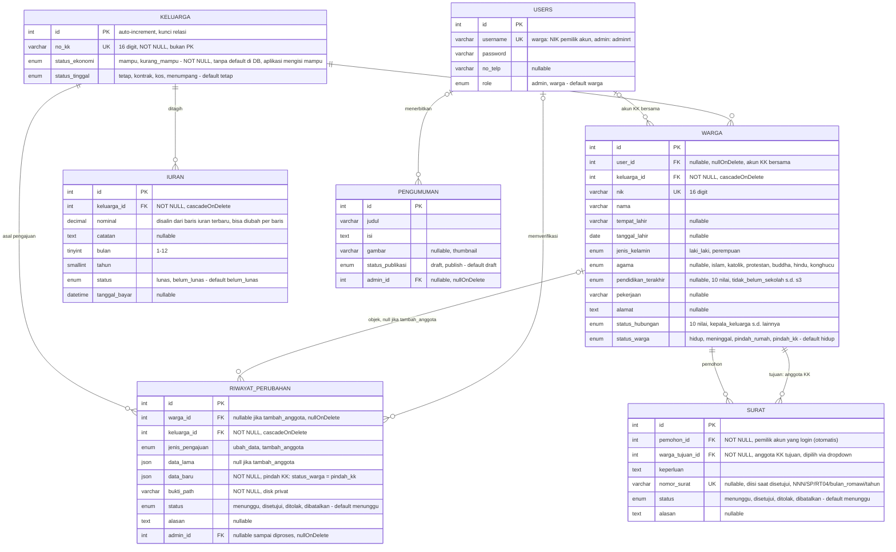

Ringkasan foreign key:

| Tabel | Kolom FK | Mengacu ke | Nullable | On delete |
| --- | --- | --- | --- | --- |
| `warga` | `user_id` | `users.id` | Ya | nullOnDelete |
| `warga` | `keluarga_id` | `keluarga.id` | Tidak | cascadeOnDelete |
| `riwayat_perubahan` | `warga_id` | `warga.id` | Ya (null jika `tambah_anggota`) | nullOnDelete |
| `riwayat_perubahan` | `keluarga_id` | `keluarga.id` | Tidak | cascadeOnDelete |
| `riwayat_perubahan` | `admin_id` | `users.id` | Ya (null sampai diproses) | nullOnDelete |
| `surat` | `pemohon_id` | `warga.id` | Tidak | Tidak ditentukan di DBML |
| `surat` | `warga_tujuan_id` | `warga.id` | Tidak | Tidak ditentukan di DBML |
| `iuran` | `keluarga_id` | `keluarga.id` | Tidak | cascadeOnDelete |
| `pengumuman` | `admin_id` | `users.id` | Ya | nullOnDelete |

---

## 4. State Machine — Status Pengajuan

Berlaku untuk `riwayat_perubahan` dan `surat`.

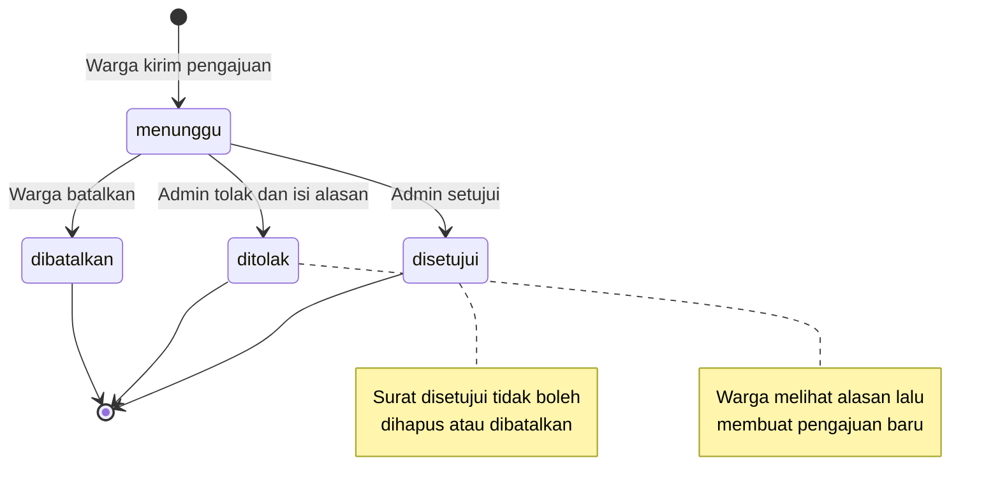

---

## 5. State Machine — Status Warga

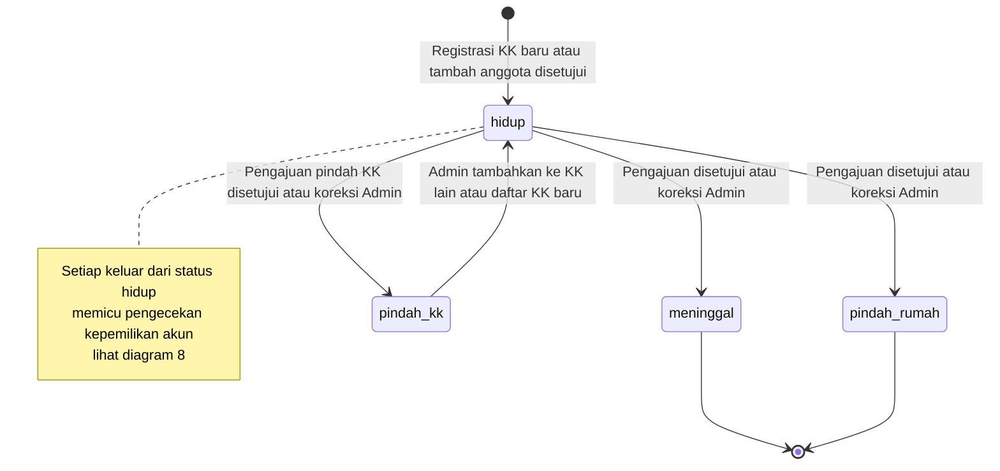

---

## 6. Workflow Registrasi Akun KK (F001)

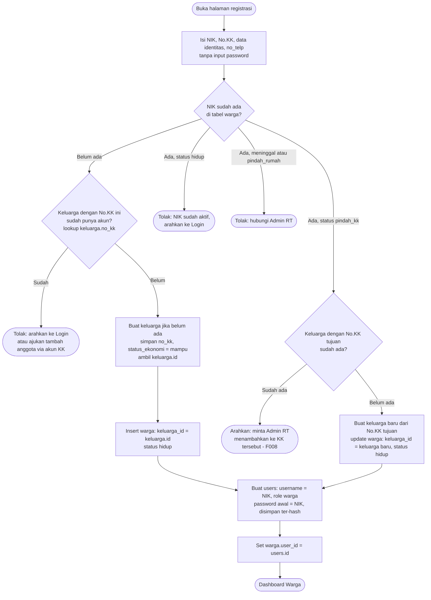

---

## 7. Workflow Perubahan Data & Verifikasi (F006, F007, F008)

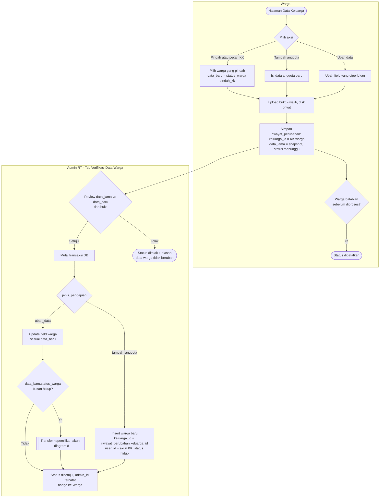

---

## 8. Workflow Transfer Kepemilikan Akun

Business rule backend pada Verifikasi Perubahan Data (F008 / UC-11). Dipicu setiap kali `status_warga` seorang warga berubah dari `hidup` ke status lain (pindah_kk, meninggal, pindah_rumah), baik lewat pengajuan disetujui maupun koreksi Admin. Pemilik akun = warga dengan `nik` sama dengan `users.username`. Seluruh anggota KK berbagi `warga.user_id` yang sama.

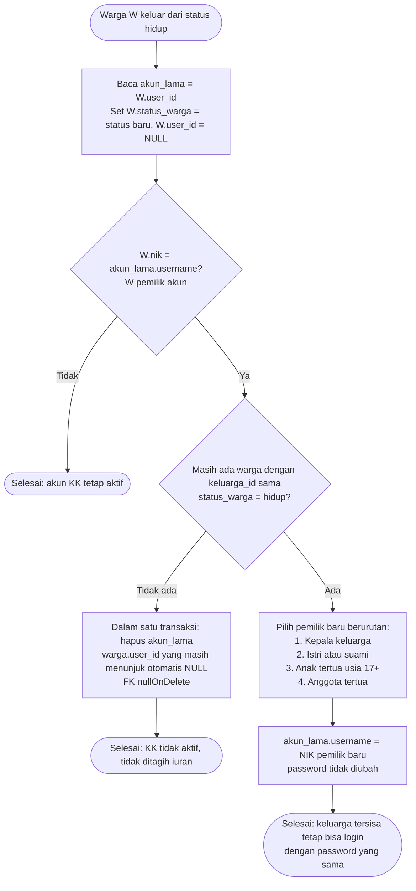

---

## 9. Workflow Autentikasi & Reset Password

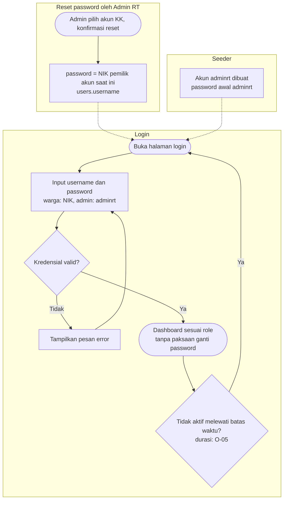

Tidak ada lupa-password lewat email; warga yang lupa meminta Admin RT melakukan reset.

---

## 10. Workflow Pengajuan Surat Pengantar (F011–F013)

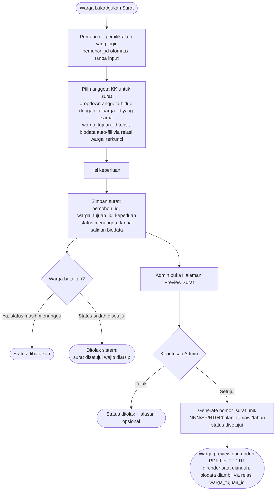

---

## 11. Workflow Iuran & Pengaturan Standar (F009, F012)

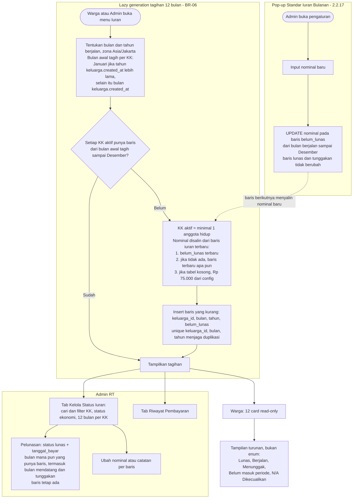

---

## 12. Catatan Sinkronisasi

Diagram ini sudah disamakan dengan `DB_WAR.dbml` terbaru (7 tabel; skema final, tidak diubah lagi) dan aturan bisnis PRD v2.6. Perubahan skema yang direfleksikan di seluruh diagram:

| Hal | Yang berlaku |
| --- | --- |
| Kunci relasi keluarga | `keluarga.id` (INT auto-increment) adalah PK. `warga`, `riwayat_perubahan`, dan `iuran` memakai `keluarga_id` (FK ke `keluarga.id`, NOT NULL, cascadeOnDelete), bukan lagi `no_kk` |
| `keluarga.no_kk` | VARCHAR(16), UNIQUE, NOT NULL; hanya identitas nomor KK. Dipakai sebagai input registrasi dan pencarian, lalu di-resolve ke `keluarga.id` |
| Unique `iuran` | `(keluarga_id, bulan, tahun)` |
| Index | `warga(keluarga_id)`, `warga(status_warga)`, `keluarga(no_kk)` |
| Penamaan tabel | `pengajuan_perubahan_data` menjadi `riwayat_perubahan`; `pengajuan_surat` menjadi `surat`. Nama modul dan fitur di UI tidak berubah |
| Tabel `surat` | Kolom `admin_id` dihapus (verifikasi surat bersifat kolektif oleh Admin RT). Kolom snapshot (`nama_lengkap`, `tempat_tanggal_lahir`, `jenis_kelamin`, `agama`, `alamat`) dihapus; biodata diambil lewat relasi Eloquent `warga_tujuan_id` |
| Konsekuensi tanpa snapshot | PDF surat yang sudah disetujui dirender dari data `warga` saat diunduh, sehingga ikut berubah bila data warga diperbarui setelah surat disetujui |
| FK nullable dan on delete | `warga.user_id`, `riwayat_perubahan.warga_id`, `riwayat_perubahan.admin_id`, dan `pengumuman.admin_id` nullable dengan nullOnDelete. `warga.keluarga_id`, `riwayat_perubahan.keluarga_id`, dan `iuran.keluarga_id` NOT NULL dengan cascadeOnDelete. `surat.pemohon_id` dan `surat.warga_tujuan_id` NOT NULL (on delete tidak ditentukan di DBML) |
| `warga.user_id` | Berlaku untuk seluruh anggota KK; pemilik akun = `warga.nik = users.username`. FK nullOnDelete: saat akun dihapus (BR-03), `warga.user_id` otomatis NULL; aplikasi tetap menghapus akun dalam satu transaksi |
| Tabel `settings` | Tidak ada. Nominal awal iuran Rp 75.000 di file konfigurasi, selanjutnya disalin dari baris `iuran` terbaru (BR-06) |
| `keluarga.status_ekonomi` | NOT NULL tanpa default di DB; aplikasi mengisi `mampu` (BR-11) |
| Password registrasi | Tidak ada input; password awal = NIK, reset Admin = NIK pemilik akun saat ini (BR-04) |
| Tagihan iuran | 12 bulan tahun berjalan mulai bulan awal tagih KK; bulan sebelumnya N/A (tanpa baris) |
| Transfer akun | Berlaku saat `hidup` berubah ke `pindah_kk`, `meninggal`, atau `pindah_rumah`, lewat pengajuan maupun koreksi Admin (BR-02) |
| Pindah KK | Dicatat sebagai `ubah_data` dengan `data_baru.status_warga = pindah_kk` |
| Tambah anggota oleh Admin | Aksi langsung, tidak melalui `riwayat_perubahan`; NIK `pindah_kk` ditarik ke KK tujuan dengan mengganti `keluarga_id` (BR-14) |
| Surat pengantar | Hanya untuk anggota KK sendiri (tanpa mode manual); `pemohon_id` otomatis dari akun login, `warga_tujuan_id` dipilih dari dropdown dan selalu diisi |
| Nomor surat | `NNN` sekuensial, reset tiap tahun kalender (BR-05) |

**Masih terbuka (PRD Bagian 15):** O-04 (badge hilang kapan), O-05 (aturan password, timeout, ukuran berkas), O-15 (nominal tersalin dari baris yang diubah khusus), O-16 (warna N/A dan isi tab Riwayat).
