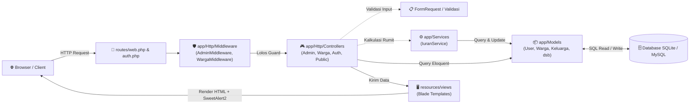
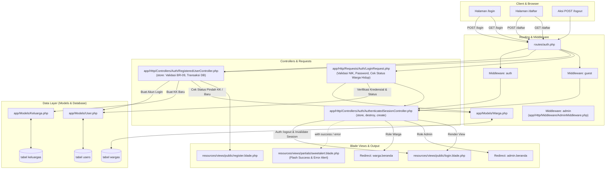
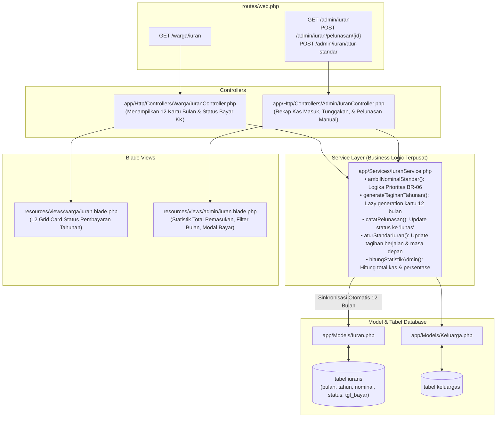
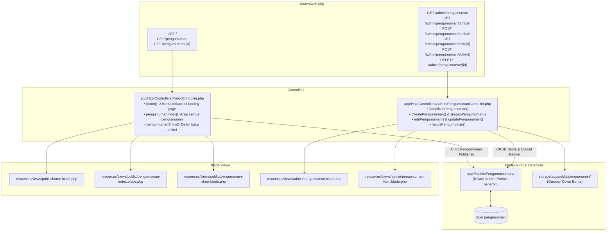
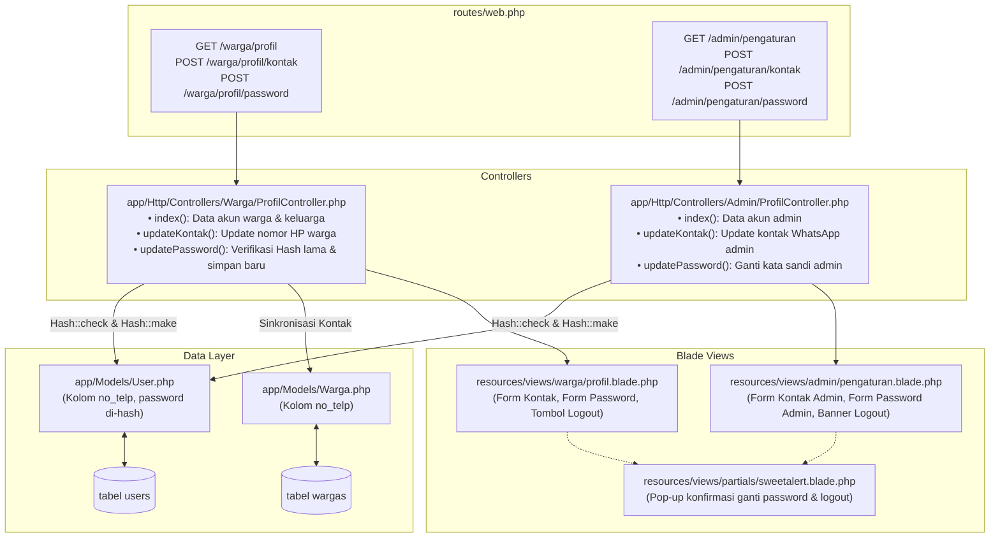

# Peta Alur File & Arsitektur Backend WargaKu 🗺️

Dokumen ini disusun sebagai panduan navigasi backend project **WargaKu (Sistem Administrasi RT 04 / RW 08)** untuk anggota tim pengembang. Fokus dokumen ini memetakan **keterhubungan nyata antar berkas fisik backend**:
> **Route / Endpoint** ➔ **Middleware** ➔ **Controller & Form Request** ➔ **Service & Logic** ➔ **Model Eloquent** ➔ **Tabel Database** ➔ **Blade View Output**.

---

## Daftar Isi Modul
1. [Pola Alur Kerja Utama Backend (Request Lifecycle)](#1-pola-alur-kerja-utama-backend)
2. [Modul 1: Autentikasi & Registrasi Akun](#modul-1-autentikasi--registrasi-akun)
3. [Modul 2: Kependudukan & Data Kartu Keluarga (KK)](#modul-2-kependudukan--data-kartu-keluarga-kk)
4. [Modul 3: Layanan Surat Pengantar Warga](#modul-3-layanan-surat-pengantar-warga)
5. [Modul 4: Pengelolaan Iuran & Kas RT](#modul-4-pengelolaan-iuran--kas-rt)
6. [Modul 5: Informasi & Pengumuman Publik](#modul-5-informasi--pengumuman-publik)
7. [Modul 6: Profil & Pengaturan Keamanan](#modul-6-profil--pengaturan-keamanan)
8. [Tabel Cheatsheet Rute ke Berkas (Quick Reference)](#tabel-cheatsheet-rute-ke-berkas)

---

## 1. Pola Alur Kerja Utama Backend

Secara umum, setiap permintaan (*request*) HTTP dari browser melintasi rantai file berikut:



---

## Modul 1: Autentikasi & Registrasi Akun

Menangani proses masuk (*login*), pendaftaran mandiri kepala keluarga baru (*registrasi KK*), pengecekan status warga aktif/pindah/meninggal (BR-09), serta keluar sistem (*logout*).

### Diagram Alur File Modul Autentikasi:



---

## Modul 2: Kependudukan & Data Kartu Keluarga (KK)

Mencakup dashboard data riil warga, penambahan anggota keluarga mandiri oleh warga maupun admin, pengajuan revisi data, verifikasi berkas pendukung oleh Admin RT, serta mutasi/penonaktifan anggota.

### Diagram Alur File Modul Kependudukan:

```mermaid
flowchart TD
    subgraph Routing ["Routing Layer (routes/web.php)"]
        R_W_KK["GET /warga/keluarga\nGET /warga/keluarga/tambah\nPOST /warga/keluarga/tambah\nGET /warga/keluarga/edit/{nik?}\nPOST /warga/keluarga/edit"]
        R_A_KK["GET /admin/data-warga\nGET /admin/data-warga/{no_kk}\nPOST /admin/data-warga/verifikasi/{id}\nGET/POST /admin/data-warga/tambah-anggota\nGET/POST /admin/data-warga/edit-anggota/{nik}"]
    end

    subgraph Controllers ["Controller Layer"]
        C_W_KK["app/Http/Controllers/Warga/KeluargaController.php\n• index()\n• tampilkanFormTambah()\n• simpanPengajuanTambah()\n• tampilkanFormEdit()\n• simpanPengajuanEdit()"]
        C_A_KK["app/Http/Controllers/Admin/WargaController.php\n• tampilkanDaftarWargaDanVerifikasi()\n• tampilkanDetailKeluarga()\n• verifikasiPengajuan()\n• simpanTambahAnggota()\n• updateDataAnggota()\n• ubahStatusKeluarga()"]
    end

    subgraph Models ["Model & Database Layer"]
        M_Warga["app/Models/Warga.php\n(Scope warga hidup, scope kepala keluarga)"]
        M_KK["app/Models/Keluarga.php\n(Relasi wargas, iurans, relasi akun)"]
        M_Riwayat["app/Models/Riwayat_Perubahan.php\n(Menampung pengajuan status menunggu/disetujui/ditolak)"]
        T_W["tabel wargas"]
        T_KK["tabel keluargas"]
        T_RP["tabel riwayat__perubahans"]
        Storage["storage/app/public/bukti_perubahan/\n(Unggahan Foto Akta / KTP / KK)"]
    end

    subgraph Views ["View Layer (Blade Templates)"]
        V_W_List["resources/views/warga/keluarga.blade.php"]
        V_W_Add["resources/views/warga/keluarga-tambah.blade.php"]
        V_W_Edit["resources/views/warga/keluarga-edit.blade.php"]
        V_A_List["resources/views/admin/data-warga.blade.php"]
        V_A_Detail["resources/views/admin/detail-keluarga.blade.php"]
        V_A_Add["resources/views/admin/warga-tambah-anggota.blade.php"]
        V_A_Edit["resources/views/admin/warga-edit-anggota.blade.php"]
    end

    %% Alur Sisi Warga
    R_W_KK --> C_W_KK
    C_W_KK -->|Ambil Anggota KK Sendiri| M_KK
    C_W_KK -->|Simpan Draft Pengajuan| M_Riwayat
    C_W_KK -->|Upload File Berkas| Storage
    C_W_KK --> V_W_List
    C_W_KK --> V_W_Add
    C_W_KK --> V_W_Edit

    %% Alur Sisi Admin
    R_A_KK --> C_A_KK
    C_A_KK -->|Daftar KK & Antrean Verifikasi| M_KK
    C_A_KK -->|Baca Antrean Pengajuan| M_Riwayat
    C_A_KK -->|Eksekusi Perubahan Disetujui (BR-08)| M_Warga
    C_A_KK --> V_A_List
    C_A_KK --> V_A_Detail
    C_A_KK --> V_A_Add
    C_A_KK --> V_A_Edit

    %% Hubungan Database
    M_Warga <--> T_W
    M_KK <--> T_KK
    M_Riwayat <--> T_RP
```

---

## Modul 3: Layanan Surat Pengantar Warga

Menangani pengajuan surat administrasi (SKU, SKTM, Keterangan Domisili, dsb), pembatalan surat mandiri oleh warga, persetujuan/penolakan oleh Admin RT, hingga pencetakan template surat bertanda tangan basah / barcode.

### Diagram Alur File Modul Surat:

```mermaid
flowchart TD
    subgraph Routes ["routes/web.php"]
        R_W_Surat["/warga/surat\nPOST /warga/surat\nPOST /warga/surat/{id}/batal\nGET /warga/surat/cetak/{id}"]
        R_A_Surat["/admin/surat\nGET /admin/surat/preview/{id}\nPOST /admin/surat/{id}/setujui\nPOST /admin/surat/{id}/tolak"]
    end

    subgraph Controllers ["Controllers"]
        C_W_Surat["app/Http/Controllers/Warga/SuratController.php\n• index(): List surat keluarga\n• simpan(): Validasi & buat pengajuan\n• batalkan(): Batalkan jika masih menunggu\n• cetak(): Cetak surat yang disetujui"]
        C_A_Surat["app/Http/Controllers/Admin/SuratController.php\n• index(): Rekap semua pengajuan warga\n• preview(): Pratinjau berkas & detail\n• setujui(): Terbitkan nomor surat otomatis\n• tolak(): Beri catatan alasan penolakan"]
    end

    subgraph ModelDB ["Model & Database"]
        M_Surat["app/Models/Surat.php\n• Relasi warga & keluarga\n• Scope status: menunggu, disetujui, ditolak"]
        M_Warga["app/Models/Warga.php"]
        T_Surats[("tabel surats")]
    end

    subgraph Views ["Blade Views"]
        V_W_Surat["resources/views/warga/surat.blade.php\n(Form Pengajuan & Tabel Riwayat)"]
        V_W_Cetak["resources/views/warga/surat-cetak.blade.php\n(Layout Cetak Kertas / Format Resmi)"]
        V_A_Surat["resources/views/admin/surat.blade.php\n(Manajemen & Filter Status Surat)"]
        V_A_Prev["resources/views/admin/surat-preview.blade.php\n(Modal / Halaman Review Persetujuan)"]
    end

    %% Hubungan Warga
    R_W_Surat --> C_W_Surat
    C_W_Surat -->|Hanya untuk Anggota KK Sendiri (BR-05)| M_Warga
    C_W_Surat -->|Insert / Update status batal| M_Surat
    C_W_Surat --> V_W_Surat
    C_W_Surat --> V_W_Cetak

    %% Hubungan Admin
    R_A_Surat --> C_A_Surat
    C_A_Surat -->|Update status & isi nomor surat| M_Surat
    C_A_Surat --> V_A_Surat
    C_A_Surat --> V_A_Prev

    %% Database
    M_Surat <--> T_Surats
```

---

## Modul 4: Pengelolaan Iuran & Kas RT

Mengelola pencatatan keuangan lingkungan RT 04, pemantauan 12 kartu bulan riil, pencatatan pelunasan warga oleh admin, hingga mekanisme penentuan tarif otomatis (BR-06) melalui service terpusat `IuranService`.

### Diagram Alur File Modul Iuran:



---

## Modul 5: Informasi & Pengumuman Publik

Menyajikan berita kegiatan, kerja bakti, dan pengumuman resmi RT ke landing page publik tanpa login, serta portal kelola (CRUD) berita bagi pengurus RT.

### Diagram Alur File Modul Pengumuman:



---

## Modul 6: Profil & Pengaturan Keamanan

Menyediakan antarmuka bagi Warga dan Admin untuk memperbarui nomor telepon WhatsApp koordinasi dan mengganti kata sandi akun secara aman dengan verifikasi password lama.

### Diagram Alur File Modul Profil:



---

## Tabel Cheatsheet Rute ke Berkas

Gunakan tabel ini untuk mencari file secara instan saat ingin mengedit atau menambah fitur baru:

| Modul | Endpoint / URL | File Controller Utama | Model yang Terlibat | Blade View Terkait |
| :--- | :--- | :--- | :--- | :--- |
| **Publik** | `GET /` | `PublicController@home` | `Pengumuman` | [home.blade.php](file:///d:/PROJECT_PBL/WargaKu/resources/views/public/home.blade.php) |
| **Auth** | `GET|POST /login` | `AuthenticatedSessionController` | `User`, `Warga` | [login.blade.php](file:///d:/PROJECT_PBL/WargaKu/resources/views/public/login.blade.php) |
| **Auth** | `GET|POST /daftar` | `RegisteredUserController` | `User`, `Keluarga`, `Warga` | [register.blade.php](file:///d:/PROJECT_PBL/WargaKu/resources/views/public/register.blade.php) |
| **Warga** | `GET /warga` | `Warga\DashboardController` | `Keluarga`, `Warga`, `Iuran`, `Surat` | [beranda.blade.php](file:///d:/PROJECT_PBL/WargaKu/resources/views/warga/beranda.blade.php) |
| **Warga** | `GET /warga/keluarga` | `Warga\KeluargaController` | `Keluarga`, `Warga`, `Riwayat_Perubahan` | [keluarga.blade.php](file:///d:/PROJECT_PBL/WargaKu/resources/views/warga/keluarga.blade.php) |
| **Warga** | `GET|POST /warga/surat` | `Warga\SuratController` | `Surat`, `Warga` | [surat.blade.php](file:///d:/PROJECT_PBL/WargaKu/resources/views/warga/surat.blade.php) |
| **Warga** | `GET /warga/iuran` | `Warga\IuranController` | `Iuran` *(via `IuranService`)* | [iuran.blade.php](file:///d:/PROJECT_PBL/WargaKu/resources/views/warga/iuran.blade.php) |
| **Warga** | `GET /warga/profil` | `Warga\ProfilController` | `User`, `Warga` | [profil.blade.php](file:///d:/PROJECT_PBL/WargaKu/resources/views/warga/profil.blade.php) |
| **Admin** | `GET /admin` | `Admin\DashboardController` | `Keluarga`, `Warga`, `Iuran`, `Surat` | [beranda.blade.php](file:///d:/PROJECT_PBL/WargaKu/resources/views/admin/beranda.blade.php) |
| **Admin** | `GET /admin/data-warga` | `Admin\WargaController` | `Keluarga`, `Warga`, `Riwayat_Perubahan` | [data-warga.blade.php](file:///d:/PROJECT_PBL/WargaKu/resources/views/admin/data-warga.blade.php) |
| **Admin** | `GET /admin/surat` | `Admin\SuratController` | `Surat`, `Warga` | [surat.blade.php](file:///d:/PROJECT_PBL/WargaKu/resources/views/admin/surat.blade.php) |
| **Admin** | `GET /admin/iuran` | `Admin\IuranController` | `Iuran`, `Keluarga` *(via `IuranService`)* | [iuran.blade.php](file:///d:/PROJECT_PBL/WargaKu/resources/views/admin/iuran.blade.php) |
| **Admin** | `GET /admin/pengumuman` | `Admin\PengumumanController` | `Pengumuman` | [pengumuman.blade.php](file:///d:/PROJECT_PBL/WargaKu/resources/views/admin/pengumuman.blade.php) |
| **Admin** | `GET /admin/pengaturan` | `Admin\ProfilController` | `User` | [pengaturan.blade.php](file:///d:/PROJECT_PBL/WargaKu/resources/views/admin/pengaturan.blade.php) |

---

*Dokumen ini selalu sinkron dengan struktur folder fisik project WargaKu RT 04 / RW 08.*
